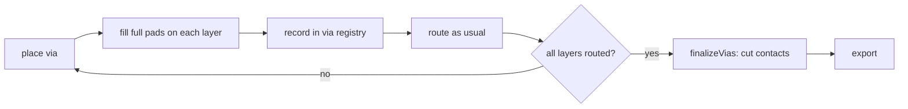
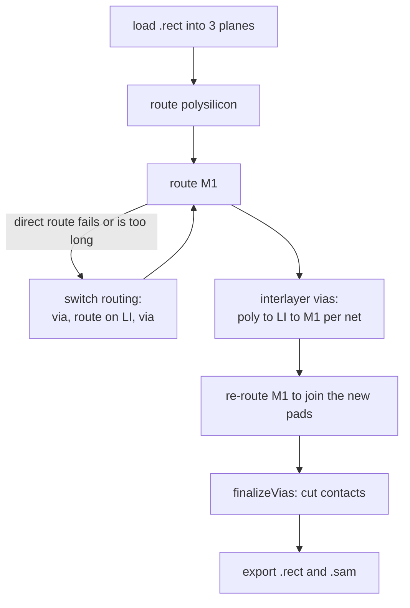

<h1 align="center">SAM_Route</h1>

<p align="center">
  <b>A detailed router for VLSI standard cells, built on the corner-stitch data structure.</b><br>
  <sub>Version 2 &nbsp;·&nbsp; C++17 &nbsp;·&nbsp; sky130 cells &nbsp;·&nbsp; header-only core</sub>
</p>

<p align="center">
  
  
  
  
</p>

---

## What is this?

SAM_Route takes a placed standard cell (a `.rect` file with diffusion, transistors, poly and pre-placed pins),
works out which tiles of each net are not yet connected, and draws the missing wires on **polysilicon**,
**local interconnect (LI)** and **metal 1**, adding vias between them where needed.

Everything lives in three **corner-stitch planes**, so the "is this spot free?" and "who is my neighbour?"
questions that routing asks all the time are cheap tile walks instead of scans of a grid.

| Plane | Holds |
|:-----:|-------|
| 0 | diffusion, transistors, polysilicon (and the poly contacts) |
| 1 | local interconnect (LI) (and the LI contacts) |
| 2 | metal 1 (and the M1 contacts) |

---

## What's new in V2

V2 keeps the routing core of V1 and reworks **how vias are placed, tracked and finally drawn**. Switch routing
(the "hop to LI when a direct route fails" fallback) was rebuilt around one via engine instead of several near-duplicate functions.

### At a glance

| | V1 | V2 |
|---|----|----|
| Via placement | `placeViaOnPoly` and `placeViaOnMetal`, two separate functions | **One** `placeVia` entry point with a `ViaOptions` struct |
| Switch routing | `attemptSwitchRouting` (poly) and `attemptSwitchRoutingMetal` (M1) | **One** `attemptSwitchRouting` used by poly, M1 and the final interlayer pass |
| Via shapes | Sizes inside the placement code | **Lookup table** (`ViaStack` + `ViaRule` in `Layers.hpp`), edit one place per technology |
| Via sites | Per-function site search | **Ranked candidates** from `findViaSites` (see below) |
| Contacts | Carved immediately when a via is placed | **Carved once, at the very end** (`finalizeVias`) |
| Connectivity across layers | Followed pointers between contact tiles ("brothers") | Follows a **via registry** of plain coordinates |
| Failed via | Handled separately in each function | **Undone cleanly** (`undoVia`): pads removed, relabelled tiles restored |
| Existing via nearby | Metal switch searched for existing LI | **Reused** when the net already sits over a via that reaches LI (`findExposedLI`, via the registry) |

### 1. One via engine

Every caller (switch routing on poly, switch routing on M1, the interlayer pass) now goes through the same stack of building blocks:

```text
insertViaPads / removeViaPads / carveViaContacts   put pads down, take them out, cut contacts
findViaSites                                       ranked list of legal pad spots near an anchor
findViaAnchors                                     what a via can attach to (poly gate tab, M1 tile)
placeViaStack                                      try the sites for one anchor, bridge, undo on failure
placeVia (+ ViaOptions)                            the single entry point
undoVia                                            take a via we created back out
```

The three via stacks are `VIA_POLY_LI`, `VIA_LI_M1` and `VIA_POLY_LI_M1`. Pad and contact sizes sit in
`viaRule()` in `Layers.hpp`:

```cpp
case VIA_POLY_LI:    return {5, 7, 3};   // pad W, pad H, contact size
case VIA_LI_M1:      return {5, 5, 3};
case VIA_POLY_LI_M1: return {5, 7, 3};
```

### 2. Contacts are cut at the end

In V1 a via carved its small contact squares the moment it was placed. Those little squares fragmented the surrounding pads, so the router saw
many small tiles and the pad edges did not behave like normal wire sources and destinations.

In V2 a via is first only **recorded** (stack, position, net) and its **full pad rectangle** is filled on every layer of the stack.
Routing therefore sees large, fully merged rectangles. Once all routing is finished, `finalizeVias()` goes through the record and cuts every contact square
in one pass, at the same positions as before.



### 3. A via registry instead of contact pointers

Layers used to be joined electrically through pointers between contact tiles, which could dangle whenever tiles were merged or deleted.
V2 stores each via as a `ViaRecord { stack, x, y, net }`. A via's pad covers every layer of its stack, so `electricallyAdjacent` just
crosses layers wherever a same-net tile overlaps a recorded pad. `findExposedLI` and `undoVia` use the same registry.

### 4. Smarter via sites

`findViaSites` ranks candidate positions instead of taking the first free one, using the bloated planes (so spacing is respected):

- the **gap** to neighbouring shapes, so vias do not squeeze into tight spots
- how much **new metal** the pad adds beyond the anchor, so a site overlapping the anchor's own metal wins
- distance from the anchor, then position as a stable tie-break
- for the interlayer pass (`preferNearM1`), the gap to the net's existing M1 is added to the ranking too

Sites are checked lazily against the bloated planes, and the search is capped by `maxSites` and `radius` in `ViaOptions`.

### 5. Poly anchors and gate tabs

For poly, the via attaches to a **gate tab**: a poly stub sitting above or below a transistor. `findViaAnchors` finds these,
including which side of the gate each one is on, so the second via of a pair can be put on the *other* side (`avoidDir`).
Gate tabs are used once, which makes the poly hop naturally repeat-safe.

### 6. Structure

The code is split by job:

| File | Role |
|------|------|
| `SAM_Route.cpp` | `main`: load, route poly, route M1, interlayer vias, re-route M1, finalize, export |
| `Header_Files/Corner_Stitch.hpp` | The tile structure, insertion, deletion, neighbour walks, bloating |
| `Header_Files/Layers.hpp` | Layer IDs, rules, via stacks and sizes, net-name registry |
| `Header_Files/Layout_Files.hpp` | Reading `.rect` files and exporting results |
| `Header_Files/Layout_Connectivity.hpp` | `electricallyAdjacent`, via registry, per-layer/net caches |
| `Header_Files/Ports_Paths.hpp` | Port selection and path shaping |
| `Header_Files/Router.hpp` | Route pairs, `attemptRoutePair` (bidirectional tile search), `routeLayer` |
| `Header_Files/Switch_Routing.hpp` | The via engine, switch routing, interlayer vias |

> `Router.hpp` and `Switch_Routing.hpp` call into each other, so include them together.

---

## How a run works



Each layer is routed for several iterations. Iteration 1 pairs tiles that line up in X, iteration 2 in Y, and later ones take nearest-neighbour
pairs, so a stuck pair gets retried differently.

---

## Quick start

```bash
# build
g++ -std=c++17 -O2 SAM_Route.cpp -o Route

# route one cell: poly first, then M1
./Route Test_Cells/_0_0syn_0_0MUX2X1.rect polysilicon,m1

# draw the result
python3 Visualize_Tiles.py
```

Outputs:

- `Output_Rects/Routed.rect`: the routed layout, contacts included
- `SAM_Files/plane{0,1,2}_routed.sam`: the three tile planes
- `layout.pdf`: a picture of the planes (via `Visualize_Tiles.py`)

Helper scripts are in `Scripts/`:

| Script | Does |
|--------|------|
| `Run_Flow.sh` | build, route one cell, visualise |
| `Test_All.sh` | build, route every cell in `Test_Cells/`, produce a PDF per cell |
| `Compare_All.sh` | regression check: `save` stores results for every cell, `check` re-runs and reports any difference |

---

## Results so far

Run over the 38 cells in `Test_Cells/`, comparing the version just before the via rework (V1 plus early fixes)
with V2. "Fail lines" counts failed port-pair attempts printed by the router. Many are retried and succeed, so it is a measure of search effort, not of final failures.

| | Before | V2 |
|---|:---:|:---:|
| Cells that hit the 40 s timeout | 3 | **0** |
| Cells where M1 did not finish | 3 | **1** |
| Total fail lines | 11,159 | **341** |
| Cells with zero fail lines | 22 | **24** |
| Wall time for all 38 cells | ~132 s | **~12 s** |

The one cell where M1 still does not finish is `g0n1n2naa_01ox0` (see below).

---

## Known limitations

- **No rip-up yet.** A net routed early can wall off a later net. In `g0n1n2naa_01ox0`, net 1's interlayer via sits below the cell,
  so its M1 wire runs through the middle and net 3 cannot cross it. V1's metal switch could rip up blocking LI; the unified V2 version does not.
- **Greedy search.** `attemptRoutePair` advances the two fronts by smallest Manhattan distance and breaks ties by a fixed
  direction order. It does not compare complete candidate paths.
- **Bloat is not refreshed after each via**, so the second via of a pair may be tested against slightly stale spacing.
- **Paths are not smoothed.** Jogs, staircases and detours remain.

## Roadmap

- [ ] Remove the leftover contact-pointer code now that connectivity comes from the via registry
- [ ] Rebuild bloated planes after each placed via
- [ ] Rip-up and re-route, with per-route records so one route can be removed cleanly
- [ ] Best-first search with sensible tie-breaking instead of the greedy walk
- [ ] Path smoothing (jogs, collinear merges, via-count penalty)
- [ ] Optional cell bounding box instead of the fixed 0..60 clamp on export

---

## Changelog

### V2 (in progress)
- Unified via placement (`placeVia`) and switch routing (`attemptSwitchRouting`)
- Via shapes moved to a lookup table in `Layers.hpp`
- Ranked via-site search; reuse of existing exposed LI; clean undo of failed vias
- Deferred contact carving (`finalizeVias`) and a via registry for cross-layer connectivity
- Guard against switch routing re-entering itself on the M1 bridge route
- Header comments and file layout reorganised by job

### V1
- Initial modular version: corner-stitch planes, bidirectional tile router, poly/M1 switch routing through LI, interlayer via stacks

---

## Authors

Stavan Mehta, Affaan Fakih
